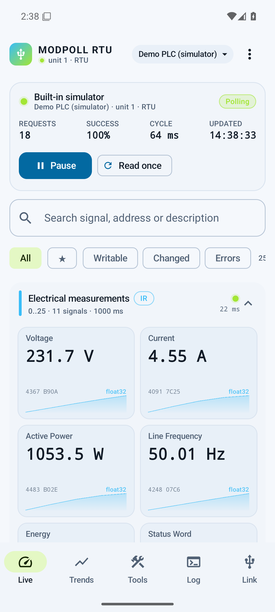
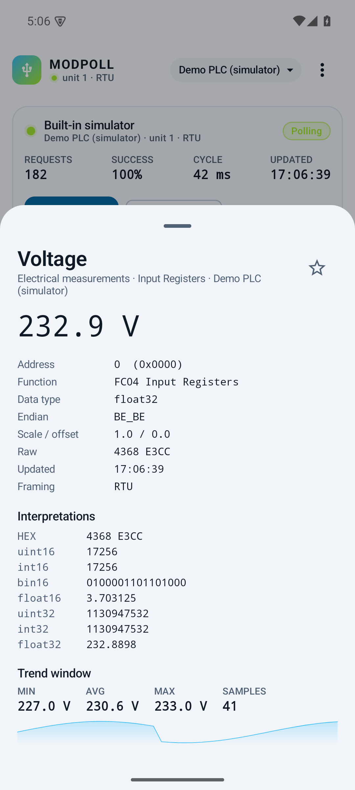
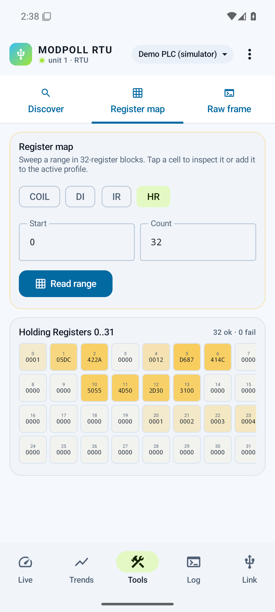
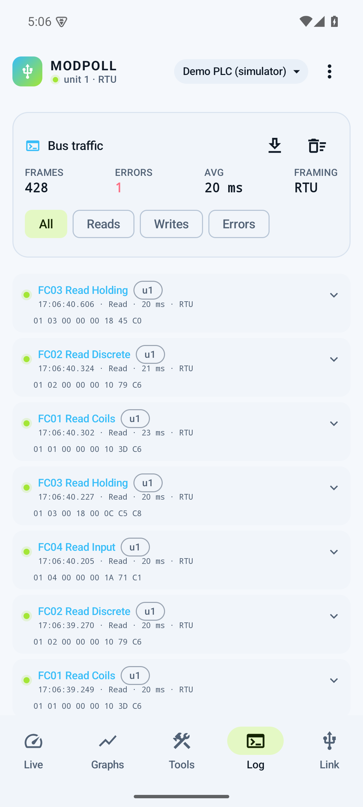
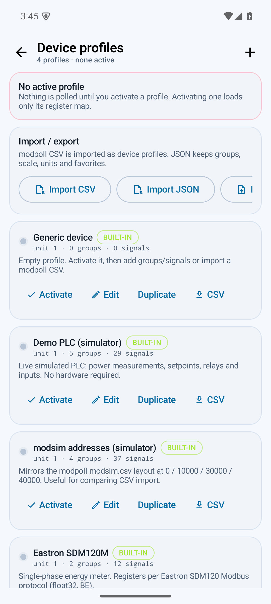
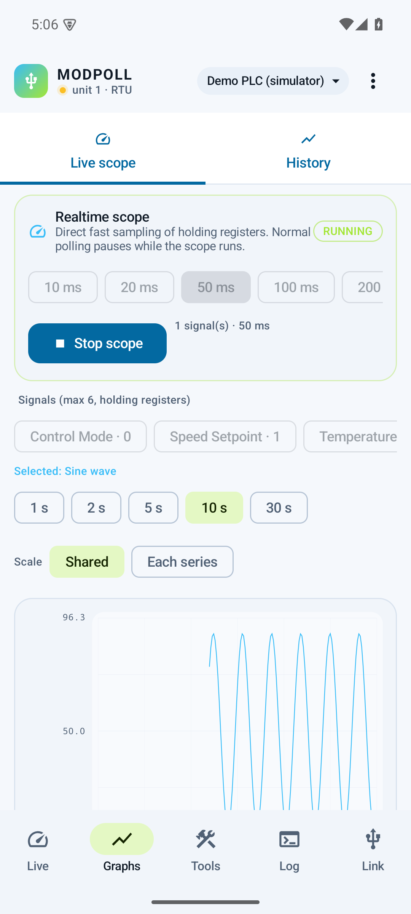

# ModPoll Mobile

A Modbus **RTU / ASCII / TCP** master for Android, driven over USB serial or a TCP socket. It follows the configuration
model of [top-maker/modpoll](https://github.com/top-maker/modpoll) (device / poll / ref CSV) but
replaces the command line with a touch-first workspace for commissioning and troubleshooting:
grouped live values, trends, register maps, slave-id scans, a raw frame tool and a byte-level log.

No MQTT, no gateway mode, no cloud dependency. The link is a USB cable or a TCP socket.



## Distribution builds

| Build | Flavor | Package | Ads | Support |
|---|---|---|---|---|
| F-Droid | `foss` | `io.github.hansfbaier.modpoll` | None | Optional Liberapay donation |
| Google Play free | `play` | `io.github.hansfbaier.modpoll` | One banner ad | Pro purchase or free F-Droid link |
| Google Play Pro | `pro` | `io.github.hansfbaier.modpoll.pro` | None | Paid app |

The F-Droid build does not contain Google Mobile Ads, UMP, or Google Play
services. The Play free build has banner ads only; it has no interstitial or
rewarded-video ads. Its upgrade prompt appears after the third launch and at
most once every seven days.

See [PLAY_STORE.md](PLAY_STORE.md) for store setup, AdMob IDs and release
commands, and [PRIVACY.md](PRIVACY.md) for the privacy policy.

## What it does

### Serial link

- USB host via [usb-serial-for-android](https://github.com/mik3y/usb-serial-for-android):
  CH340/CH341, CP210x, FTDI, PL2303, CDC-ACM and related chips
- Baud 1200…921600, data bits 5–8, parity none/even/odd, stop bits 1/2
- Modbus RTU (binary + CRC16) **and** Modbus ASCII (hex + LRC + CRLF)
- Per-request timeout, retries, inter-frame gap, configurable unit id
- Optional auto-reconnect and auto-disable of a failing poll group after three failures
  (the equivalent of `--autoremove`)
- Hot-plug aware device picker; USB permission handled by the app
- **Modbus TCP** (MBAP) to a host and port, over Wi-Fi or Ethernet

### Modbus data model

- FC01 coils, FC02 discrete inputs, FC03 holding registers, FC04 input registers
- FC05/FC06 single writes, FC15/FC16 multiple writes
- Types: `bool`, `bool8`, `bool16`, `uint16`, `int16`, `uint32`, `int32`, `uint64`, `int64`,
  `float16`, `float32`, `float64`, `stringN`
- Endianness `BE_BE`, `BE_LE`, `LE_BE`, `LE_LE`
- Scale and offset, engineering units, decimal places
- `address:bit` boolean references on register tables
- Raw PDU tool for frames the UI does not model

### Profiles

- A profile is one slave: unit id, poll groups, signal mappings
- **No profile is active by default.** Activate one in **Profiles** to load its register map.
  Deactivate it again to stop polling without deleting anything.
- Only the active profile is polled; switching profiles loads that profile's map and unit id
- A built-in **Generic device** profile starts with zero groups. Add signals from the register map
  or import a modpoll CSV.
- Each group is one contiguous read block with its own interval, so a screen of values usually
  costs one request per group
- Visual editor for groups and signals, duplicate/delete, JSON import/export
- modpoll CSV import and export
- Other built-in profiles: Demo PLC simulator, modsim address layout, Eastron SDM120M

### Workspace

- **Live** — grouped cards, live values, raw hex, per-signal sparkline, search and filters
  (favorites / writable / changed / errors), write-capable detail sheet with decoded
  interpretations and bit toggles
- **Graphs → Live scope** — high-rate oscilloscope view for up to six holding-register signals.
  Target interval 10–1000 ms, rolling 1–30 s window, shared or per-series scaling, actual sample
  rate, read/error counters. Normal polling pauses while the scope runs and resumes on stop.
- **Graphs → History** — multi-signal trend chart up to six series, selectable window, freeze,
  min/avg/max for longer-term supervision
- **Tools** — slave-id scan, 32-register block heatmap with a named, typed “add signal” dialog,
  raw PDU builder that decodes register values and coil states in the reply
- **Log** — every request/response with timing, CRC/LRC status, exception codes, CSV export
- **Link** — device selection, serial and Modbus settings, framing, built-in simulator

| Signal detail | Register map |
|---|---|
|  |  |

| Traffic log | Profiles |
|---|---|
|  |  |



## Quick start without hardware

1. Install and open the app. No profile is active on first launch, so nothing is polled.
2. **Link → Start simulator**. If no profile is active (or the active one has no signals), the
   *Demo PLC* profile is activated automatically.
3. Open **Live**. The simulator answers on units 1–3 with live float, integer, string, coil and
   discrete data.
4. Tap a tile to inspect raw words, switch endianness interpretations, or write a value.
5. Open **Tools → Register map**, read 32 holding registers, tap a cell, give it a name and type,
   then **Add signal**. The new signal is saved in the active profile and appears as a Live card.
6. Open **Graphs → Live scope**, choose holding-register signals and a 10–1000 ms interval, then
   **Start scope**. The demo profile includes sine, sawtooth and counter registers for testing.

The simulator uses the same framing and function-code validation as a real device, including
exception responses (illegal address), timeouts for missing unit ids and both RTU and ASCII
framing. It is part of the test suite as well.

## Build

Requirements:

- JDK 17
- Android SDK platform 35 and build-tools 35.0.0
- Gradle wrapper is included (Gradle 8.13)

```bash
# point Gradle at your SDK
echo "sdk.dir=$HOME/android-sdk" > local.properties

# Pick a flavor: foss (F-Droid), play (ads), or pro (paid)
./gradlew :app:assembleFossDebug
adb install -r app/build/outputs/apk/foss/debug/app-foss-debug.apk
```

Build the other variants with `:app:assemblePlayDebug` and
`:app:assembleProDebug`. Release builds and Play bundles are described in
[PLAY_STORE.md](PLAY_STORE.md).

Unit tests (CRC, framing, endianness, codecs, CSV, simulator integration):

```bash
./gradlew :app:testFossDebugUnitTest
```

## Using Modbus TCP

1. Activate a device profile.
2. Open **Link → Modbus TCP**.
3. Enter the host/IP and port (default 502), then **Connect TCP**.
4. The active profile's unit id, groups and signals are polled over MBAP framing.

The app requests the standard `INTERNET` permission for TCP sockets. The app itself has no
telemetry and no cloud service; the Google Play free build additionally contains AdMob for its
banner ad. TCP traffic is not encrypted; use it on a trusted control network or a VPN.

## Using a USB-RS485 adapter

1. Connect the adapter with a USB-OTG cable. The device must be a USB host or support OTG.
2. Grant the USB permission prompt.
3. Select the adapter in **Link**, choose baud rate / parity / stop bits.
4. Choose **RTU** or **ASCII** framing.
5. Select a profile (or import a CSV), set the unit id, then **Connect selected device**.

For a two-wire RS-485 bus, A/B polarity and termination are still your responsibility. Many
adapters switch the driver direction automatically; the app does not drive RTS as a TX-enable
signal.

## modpoll CSV compatibility

The importer accepts the familiar format:

```csv
device,SDM120M,1,,,
poll,input_register,0,2,BE_BE
ref,voltage,0,float32,r,Volts
```

- Addresses are used **literally**, exactly as in modpoll (for example `40000`).
- `bool8` / `bool16` on coil and discrete-input polls are packed 8- or 16-bit groups in the file.
  Internally the app stores absolute bit addresses (`file address × 8`), and converts back on
  export. A `bool` reference in a bit table is treated as an 8-bit group, like modpoll.
- Register `bool` references should use `address:bit`. A missing bit produces an import warning and
  defaults to bit 0.
- `stringN` occupies `ceil(N / 2)` registers.
- `scale` multiplies the raw value (the app also supports an optional offset in its own editor).
- `rw` marks the signal writable.
- Invalid rows are reported with line numbers; valid rows around them are kept.

Not implemented: MQTT publishing, Modbus UDP, remote URL configuration, multi-device simultaneous
polling, daemon mode and Docker. One link and one active profile are used at a time.

## Architecture

```text
data/      profiles, signals, CSV import/export, JSON persistence
modbus/    CRC16, RTU/ASCII/MBAP framing, master, codecs, TCP/USB/simulated transports
engine/    poll scheduler, per-signal history, writes
usb/       USB host enumeration, permission flow, driver probing
ui/        Compose Material 3 workspace (Live, Trends, Tools, Log, Link, Profiles)
```

The master serializes every transaction with a mutex (half-duplex bus), validates CRC/LRC and
unit/function codes, retries transport-level failures, and records each attempt. The poll engine
issues one request per group per interval and decodes all signals from that block.

## Known limitations

- USB requires a host/OTG port and permission after each re-attach. TCP requires the standard
  `INTERNET` permission and a reachable host.
- One link at a time. Multi-drop buses can be scanned, but polling is per profile/unit.
- Numeric trend history is stored as `Double`; 64-bit integers above 2^53 lose precision in
  charts. The detail sheet shows exact integer values.
- The write path encodes using the signal's declared scale/offset; verify writes on a bench
  device before using them in production.
- Very long ASCII frames and unusual vendor timings may require a larger timeout.
- The live scope is a holding-register viewer. While it runs, normal profile polling is paused;
  the actual sample rate is limited by baud rate or network, device response time and transport latency.
- Scope history is an in-memory ring buffer (3000 samples per series) and is not exported.

## License

Copyright (C) 2026 Hans Baier.

This program is free software: you can redistribute it and/or modify it under the terms of the
GNU General Public License as published by the Free Software Foundation, either version 3 of the
License, or (at your option) any later version.

It is distributed in the hope that it will be useful, but WITHOUT ANY WARRANTY; without even the
implied warranty of MERCHANTABILITY or FITNESS FOR A PARTICULAR PURPOSE. See `LICENSE` for the
full text.

Third-party components keep their own licenses, notably the MIT-licensed
[usb-serial-for-android](https://github.com/mik3y/usb-serial-for-android) driver library.
The Google Play free build also includes the proprietary Google Mobile Ads SDK;
it is absent from the F-Droid and Pro builds.

## Credits

- Configuration model and semantics inspired by
  [top-maker/modpoll](https://github.com/top-maker/modpoll) (MIT).
- USB serial drivers by [mik3y/usb-serial-for-android](https://github.com/mik3y/usb-serial-for-android)
  (MIT).

ModPoll Mobile is an independent project and is not affiliated with top-maker/modpoll.
